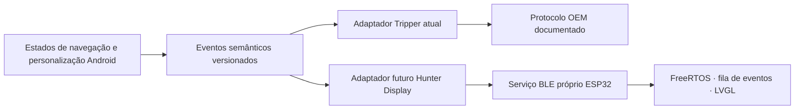

# Hunter Display: pesquisa de tela circular independente

Pesquisa em 21/11/2026. **Somente estudo: nenhuma compra, firmware novo ou intervenção na moto.** O Tripper original não aceita GIFs, vídeo ou framebuffer livre no protocolo conhecido. Uma segunda tela seria outro produto, com outro protocolo BLE.

## Comparação de placas

Especificações abaixo são do fabricante; desempenho e adequação à motocicleta não foram medidos.

| Item | Waveshare ESP32-S3-LCD-1.28 | ESP32-S3-Touch-LCD-1.46 / B | Alternativa Touch-AMOLED-1.43 |
|---|---|---|---|
| CPU | ESP32-S3R2, LX7 dual-core até 240 MHz | S3R8, mesma arquitetura/frequência | S3R8, mesma arquitetura/frequência |
| SRAM / PSRAM / flash | 512 KB / 2 MB / 16 MB | 512 KB / 8 MB / 16 MB | 512 KB / 8 MB / 16 MB |
| Painel | IPS circular, 240×240, 65 mil cores | TFT circular, 412×412, 16,7 milhões | AMOLED circular, 466×466, 16,7 milhões |
| Controlador / barramento | GC9A01A / SPI | SPD2010 / QSPI, touch I²C | QSPI, touch capacitivo I²C |
| Comunicação | Wi-Fi 2,4 GHz e BLE 5 | Wi-Fi 2,4 GHz e BLE 5 | Wi-Fi 2,4 GHz e BLE 5 |
| Armazenamento extra | Flash; sem slot TF indicado nessa placa | Slot TF/microSD | Slot TF/microSD |
| Entrada / alimentação | Botões BOOT/RESET, USB-C; sem touch na versão indicada | Touch, botões laterais e USB-C | Touch, botões e USB-C; opção de caixa metálica |
| Referência de tamanho | Área ativa Ø32,4 mm; corpo circular PCB Ø36,5 mm, além da saliência USB | Diâmetro nominal de tela ≈37,1 mm* | Diâmetro nominal ≈36,3 mm* |
| Preço oficial consultado | US$15,99 | US$21,99–26,99 conforme vidro | US$26,99–31,99 conforme caixa |

\* Conversão geométrica da diagonal nominal em polegadas, **não medida da PCB, carcaça ou fixação**. O corpo, conectores, altura de componentes e tolerâncias precisam ser retirados dos desenhos mecânicos de cada SKU antes de projetar caixa. Não assumir intercambiabilidade entre 1.46, B e C, nem entre 1.43 e 1.43C.

O [desenho mecânico 1.28](https://docs.waveshare.com/assets/images/Esp32-s3-lcd-1.28-003-25ce15c59f8b0362f62e7581d6ca464b.webp) indica raio de 18,25 mm no corpo circular; não define uma caixa pronta.

Fontes primárias: [especificação 1.28](https://docs.waveshare.com/ESP32-S3-LCD-1.28), [produto/preço 1.28](https://www.waveshare.com/product/esp32-s3-lcd-1.28.htm), [especificação 1.46](https://docs.waveshare.com/ESP32-S3-Touch-LCD-1.46), [variantes/preço 1.46](https://www.waveshare.com/product/esp32-s3-touch-lcd-1.46b.htm), [produto AMOLED](https://www.waveshare.com/product/esp32-s3-touch-amoled-1.43.htm), [documentação AMOLED](https://www.waveshare.com/wiki/ESP32-S3-Touch-AMOLED-1.43).

**Não confirmado:** luminância em cd/m², leitura sob sol direto, consumo completo em mA com brilho/BLE ativos, qualificação automotiva, IP contra chuva ou ensaio de vibração. Nenhuma dessas placas deve ser tratada como instrumento pronto para uso externo. A opção de caixa/vidro não comprova vedação. Touch capacitivo não garante funcionamento com luvas: priorizar comandos no Android parado ou botões físicos no protótipo.

As páginas oficiais disponibilizam recursos/demos Arduino e ESP-IDF/LVGL. Fixar versões de placa, driver e LVGL que foram efetivamente compiladas; exemplos de versões distintas não são intercambiáveis. A [demo ESP-IDF 1.46](https://docs.waveshare.com/ESP32-S3-Touch-LCD-1.46/ESP-IDF) demonstra periféricos e interface, não valida uso na moto. Comunidade: suporte e repositórios Waveshare, Espressif e LVGL; manutenção futura depende de pinagem/revisão documentadas, não apenas da aparência circular.

## Custos e disponibilidade no Brasil

Preços em dólares são anúncios do fabricante, sem frete, tributos, cartão ou prazo. Não há cotação de compra nem estoque reservado. Encontrei um [anúncio em português da categoria 1.28 a R$132,42](https://eletronicadachina.com.br/produto/lcd-development-board-128-ips-round-gc9a01-display-driver-suporte-wi-fi-bluetooth-esp32-s3), que encaminha a outra loja: isso **não confirma estoque nacional nem o SKU Waveshare 26541**. Não confirmei fornecedor brasileiro e estoque para os SKUs exatos 1.46/AMOLED, nem checkout para entrega no Brasil.

Orçar placa + cabo/fonte USB adequados + microSD quando aplicável + caixa/suporte + vedação/proteção do cabo. Cotar esses itens e o custo final de importação antes de comprar; não converter o preço da placa em promessa de custo instalado. Nenhuma peça foi comprada nesta tarefa.

## Memória e carga gráfica

Cálculos próprios de framebuffer, sem overhead do sistema:

| Resolução | RGB565, um frame | Dois frames RGB565 | ARGB8888, um frame | RGB565 bruto a 15 fps |
|---|---:|---:|---:|---:|
| 240×240 | 115.200 B | 230.400 B | 230.400 B | 1,73 MB/s |
| 412×412 | 339.488 B | 678.976 B | 678.976 B | 5,09 MB/s |
| 466×466 | 434.312 B | 868.624 B | 868.624 B | 6,51 MB/s |

A SRAM de 512 KB é compartilhada por stacks, DMA, BLE e RTOS; não equivale a um framebuffer livre desse tamanho. Usar PSRAM e buffers parciais/DMA compatíveis com o driver. A taxa bruta é só orçamento de tráfego: rasterização, cópia, acesso ao cartão, barramento e sincronização reduzem a taxa real. A documentação da 1.28 menciona SPI até 80 MHz; isso não prova FPS ou estabilidade nessa frequência. Para a 1.46, a imagem tem quase três vezes mais pixels, apesar da PSRAM maior.

- **Imagens e sequências:** frames pequenos pré-convertidos ou JPEGs no cartão simplificam o primeiro teste. Não carregar todos os frames na RAM. Marcar limites de dimensão, tamanho total, duração e quantidade de arquivos.
- **GIF:** LVGL oferece widget e decoder. A [documentação atual](https://lvgl.io/docs/open/widgets/gif) informa cerca de 25 kB mais `(bytesPorPixel + 1) × largura × altura`; a [documentação 9.1](https://lvgl.io/docs/open/9.1/libs/gif) usa outro decoder e orçamento. Fixar a versão, considerar framebuffer/paleta/transparência e medir picos. AnimatedGIF/gifdec são opções a avaliar com suas licenças antes de incorporar.
- **Vetores:** relógio, ponteiro e símbolos LVGL tendem a ser o caminho mais simples. [Lottie/ThorVG](https://lvgl.io/docs/open/widgets/lottie) exige rasterização e buffer ARGB8888, além de C++ e recursos habilitados. Não prometer Lottie complexo a 60 fps.
- **Vídeo simplificado:** MJPEG é uma sequência de JPEGs independentes; pode ser viável em baixa resolução/fps, após benchmark. O [codec de software ESP_NEW_JPEG](https://developer.espressif.com/blog/2025/09/esp-new-jpeg-introduction/) tem otimizações para S3. Isso não transforma a placa em reprodutor de MP4/H.264 convencional com áudio sincronizado. Não foi implementado nem medido vídeo nesta tarefa.

## Software e transferência de conteúdo

Proposta de bancada: ESP-IDF + FreeRTOS + LVGL, partindo do exemplo oficial da placa escolhida. Manter um único dono da UI LVGL e passar eventos por fila; decodificação/IO separados do loop de desenho. A [integração NimBLE do ESP-IDF](https://docs.espressif.com/projects/esp-idf/en/stable/esp32s3/api-reference/bluetooth/nimble/index.html) oferece uma base BLE com execução no FreeRTOS. Priorizar latência de eventos de navegação sobre animações e IO.

BLE futuro deve levar eventos pequenos e IDs de conteúdo, não vídeo bruto. Para assets: USB/microSD primeiro; se houver envio remoto depois, usar pareamento explícito, limite de tamanho, manifesto/versionamento, digest, escrita temporária e ativação atômica após validação. Transferência de arquivo não é atualização de firmware. Não implementar OTA ou escrita de firmware no Tripper original.

## Tachyon: implementação conferida, não somente README

Revisão: [`6abe932cf69f1fc639c4ec94df555ae06a2a6417`](https://github.com/scrapwoodic/Tachyon/tree/6abe932cf69f1fc639c4ec94df555ae06a2a6417), atualizada em 14/11/2026; seis commits na consulta. O [main.c](https://github.com/scrapwoodic/Tachyon/blob/6abe932cf69f1fc639c4ec94df555ae06a2a6417/main/main.c) cria tarefas GPIO/UART usando FreeRTOS e HAL pequena. O CMake registra esses arquivos e o driver; não encontrei inicialização do painel, renderer LVGL, parsing BLE, GIF ou relógios implementados na árvore examinada. O roadmap do README mantém essas frentes em aberto. Não compilei esse firmware nem executei hardware.

É uma referência de organização de HAL e intenção de produto, não uma plataforma gráfica pronta para integrar. O README declara MIT e aponta para `LICENSE`, mas esse arquivo não existe nessa revisão e a API GitHub informa licença não detectada. **Não copiar código até o autor esclarecer/publicar os termos.** Nenhum código ou asset Tachyon foi incorporado ao Hunter Lab.

## Segurança e arquitetura futura

Primeiro protótipo **de bancada, por USB**, sem conexão à bateria de 12 V, chicote, ECU ou ABS. Não fazer instalação elétrica nesta fase. Antes de qualquer uso externo: medir consumo e temperatura, avaliar fonte USB/regulação/proteções adequadas, resistência do cabo, retenção mecânica, água, condensação, vibração, reflexo e leitura com viseira/óculos. Não executar animações distrativas em movimento. Não usar luvas ou touchscreen como único meio de encerrar uma animação.

Eventos futuros sugeridos: manobra, distância, ETA, estado GPS, radar e seleção de tema; incluir versão, sequência, unidade e expiração. Não compartilhar UUIDs/pacotes OEM nem colocar dependências ESP32 no core do MVP. Definir capacidades por display e degradar de forma explícita. São propostas arquiteturais: nenhum adaptador ESP32 foi implementado nesta versão.

**Recomendação de protótipo:** a 1.46 oferece 8 MB de PSRAM e microSD com custo de placa próximo da 1.28, tornando-a a candidata principal para liberdade gráfica. A 1.28 é a alternativa econômica para setas/relógio. AMOLED é alternativa de contraste e resolução, sem presumir vantagem ao sol. Antes de escolher: obter desenho mecânico do SKU, cotação entregue no Brasil e demonstração de brilho. Na bancada, medir FPS, latência BLE, picos de RAM, temperatura e consumo com um GIF pequeno, uma sequência de JPEGs e navegação simulada. Nenhuma compra recomendada sem resolver essas verificações.
