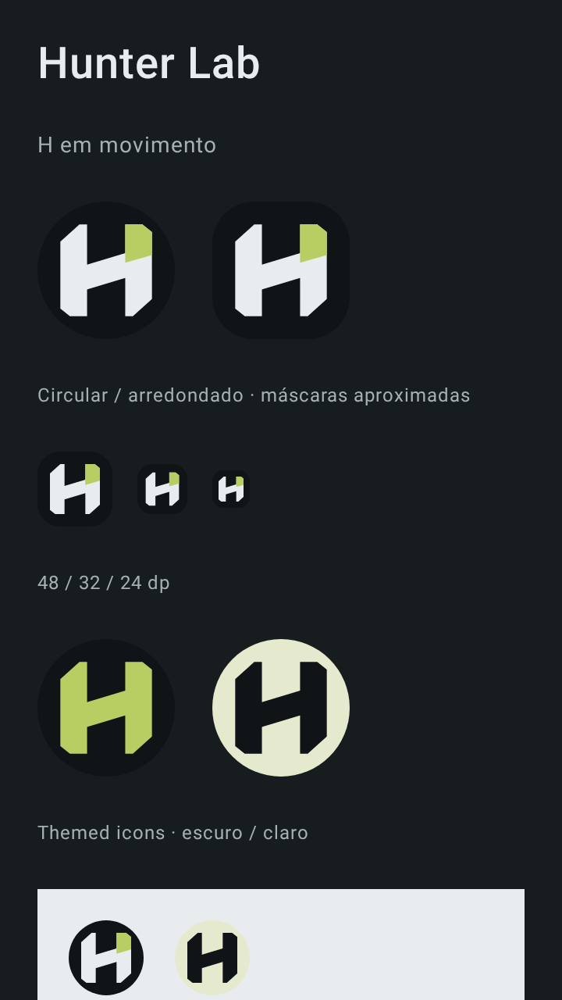
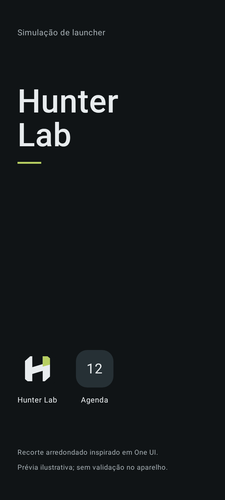
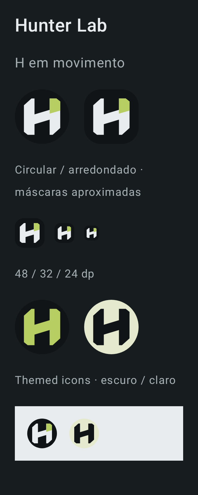
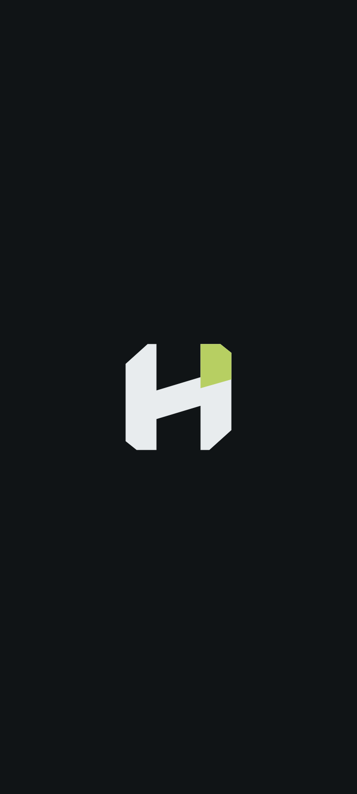

# Hunter Lab — H em movimento

Marca vetorial original criada para este projeto em 21/11/2026. Dois montantes sólidos, cortes opostos e uma travessa ascendente formam um H reconhecível. O pequeno acento superior sugere movimento e experimentação; não reproduz a marca Royal Enfield, uma bússola ou uma engrenagem. Não foi fornecido SVG de referência nesta sessão. Não se afirma exclusividade jurídica nem foi feita pesquisa de anterioridade no INPI.

## Arquivos e cores

- [Master com fundo](hunter-lab.svg), [símbolo transparente](hunter-lab-symbol.svg), [monocromático transparente](hunter-lab-monochrome.svg).
- Fundo grafite `#101416`; tinta `#E8ECEE`; acento verde-lima `#B7CF62`. Verde limitado ao topo direito, sem brilho, gradiente ou sombra embutida.
- Android: `drawable/ic_launcher_foreground.xml`, `drawable/ic_launcher_monochrome.xml`, fundo separado `@color/hunter_brand_background` e os dois `mipmap-anydpi/ic_launcher*.xml`.
- O Manifest já apontava para `ic_launcher` e `ic_launcher_round`; essas referências foram preservadas e agora resolvem para a nova marca. `applicationId`, versão, permissões e assinatura não mudaram.
- A abertura Android 12+ existente reutiliza o foreground; apenas o fundo de splash ganhou o token da marca. A composição abaixo ilustra a abertura, sem simular timing/animação do sistema.

## Prévias verificadas

Renders Android Layoutlib de componentes Compose usando os **drawables reais**. Prancha com projeção da camada de 108 dp no viewport central de 72 dp, máscaras aproximadas; não são capturas de aparelho ou emulador. A máscara específica da versão do One UI/Pixel Launcher do usuário ainda precisa ser conferida. Nenhuma instalação, Bluetooth ou comunicação com a moto foi executada.

| Ícone, escala e temas | Launcher ilustrativo |
|---|---|
|  |  |

| 320 dp / fonte 150% | Composição de abertura |
|---|---|
|  |  |

## Critérios de revisão

- Vetores 108 × 108 dp, símbolo central 48 × 48; todos os vértices ficam dentro do círculo seguro de raio 33 dp (maior raio: 31,241 dp). Sem máscara desenhada no foreground. A mesma geometria compõe o monocromático.
- Revisão visual em 48, 32 e 24 dp; nenhuma letra pequena ou detalhe fino indispensável. Renders em fundo claro e escuro. O acento não é necessário para reconhecer o H.
- Contraste calculado contra grafite: tinta **15,58:1**, lima **10,69:1**. Cores do themed icon ficam sob controle do launcher; não se promete esses valores em qualquer tema.
- Prancha de prévia com rolagem, revisão em 320 dp e fonte 150%, sem texto cortado. Não há nova tela/interação de produto: `BrandPreviews.kt` serve à revisão no Android Studio.
- Guia oficial: [ícones adaptativos](https://developer.android.com/develop/ui/compose/system/icon_design_adaptive), [máscaras OEM no AOSP](https://source.android.com/docs/core/display/adaptive-icons). A existência da camada monocromática não garante que todos os launchers ofereçam themed icons.

## Integração controlada

Branch `feat/hunter-identity-research`, worktree `HunterLab-identity-research`, criada da main `a5fad26` (0.3.0). A base Graphite Grey está na branch local `feat/ui-graphite-grey` (`4b7169b`) e já é ancestral da branch Playground `306a3cf`; ainda não está na main. **Nenhuma dessas branches foi mesclada ou alterada nesta entrega.**

Comparação antes da edição: recursos launcher/tema XML eram iguais entre main, Graphite e Playground; o tema Compose em andamento ficou intocado. A marca pode ser integrada por revisão dos recursos, sem trazer a UI alternativa. O único ponto comum detectado é a linha de branches do workflow CI: ao consolidar, preservar tanto o filtro do Playground quanto `feat/hunter-identity-*`. O handoff e roadmap também devem ser combinados, preservando as entradas das duas frentes.

Não foi adicionada dependência Android, não houve mudança de pacote/versão/chave, e `protocol/`, `core/`, BLE, navegação e GPS permanecem intactos. O projeto continua com a decisão de licença pendente; nenhum asset de terceiro ou nova licença foi introduzido.

Pendente no Samsung: conferir máscara/tamanho real, themed icons se oferecidos pelo launcher, transição do splash e eventual cache do ícone. Instalação/abertura não foram realizadas nesta tarefa passiva; não iniciar testes da moto para validar a marca.

## Validação da branch

- `./gradlew test :app:lintDebug :app:assembleDebug --max-workers=2 --console=plain`: **BUILD SUCCESSFUL**.
- **421 testes**: protocol 115, core 287, app 19; zero falhas, erros ou ignorados. Trata-se da suíte da main 0.3.0; a suíte 0.3.1 deve ser repetida quando houver integração controlada.
- Lint debug: **No issues found**. Actionlint aprovado. Três avisos Kotlin já existentes na base (máscara de senha e `!!` desnecessário), sem alteração nessas áreas.
- Quatro renders Layoutlib finais inspecionados. O renderer emitiu avisos de timeout lento durante inicialização; terminou com sucesso. Capturas com glifos incompletos em uma tentativa intermediária foram descartadas e substituídas pelos renders finais revisados.
- Gitleaks 8.30.1: histórico completo e cópia dos 207 arquivos candidatos à publicação sem achados. A cópia exclui gerados/ignorados; uma varredura inicial da pasta em uso encontrou locks do Gradle, por isso foi substituída pela verificação do conteúdo publicável, sem arquivos bloqueados.
- APK local: `build/distributions/HunterLab-0.3.0-brand-review-debug.apk`; applicationId `dev.hunterlab.app.debug`, versionName `0.3.0-debug`, versionCode 5. SHA-256: `6fbc2adb88b7bb00e91741db47a64f7ceaed497245668df6daea45226fab20f4`.
- Certificado SHA-256: `cd7734c98417fe084fb5d9c149c98d897db6b271cc3c32f999de4b4d855033cf`, mesma identidade debug local anteriormente registrada; nenhum keystore criado ou alterado. Compatibilidade com instalação do Samsung não foi testada.
- **Não instalar esse APK sobre uma 0.3.1 (code 6)**: esta branch não incorpora o Playground. O APK serve à revisão dos recursos, sem release estável. Integrar os assets à versão escolhida e repetir a suíte antes de fornecer uma atualização para uso.
