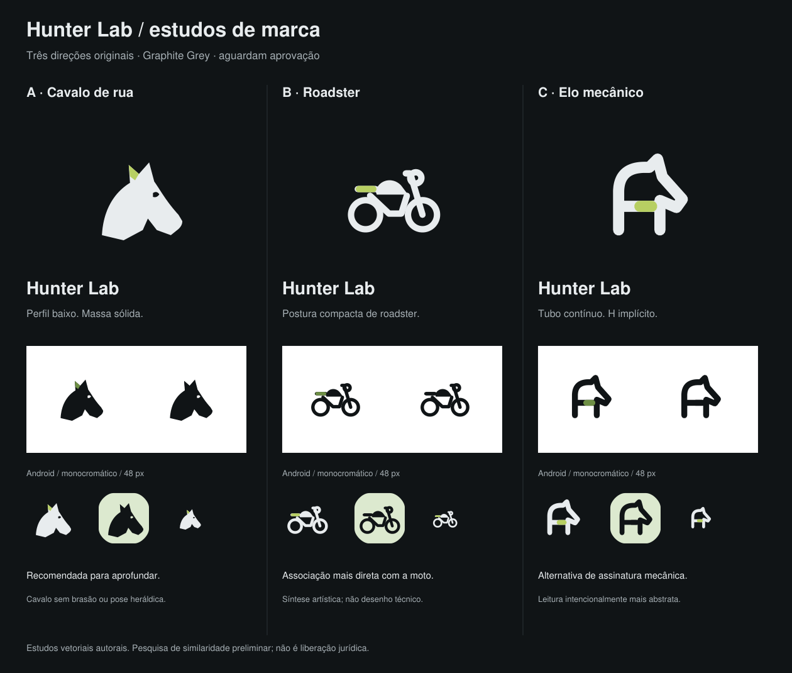
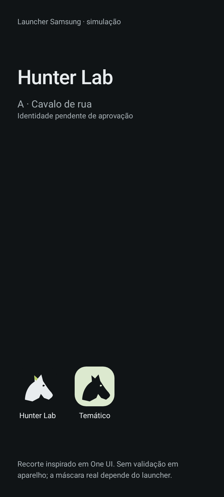
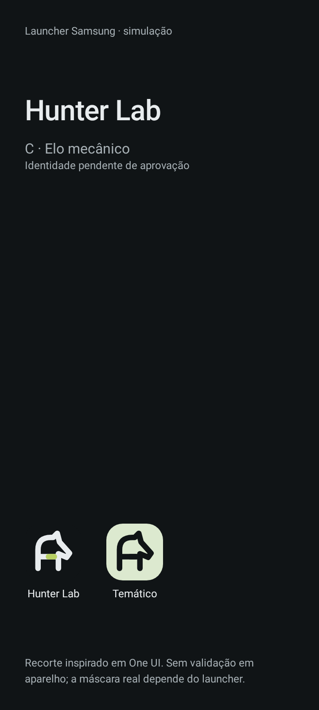

# Hunter Lab — três direções de marca

**Status: propostas para aprovação. Nenhuma marca nova foi aplicada à main.** A consolidação funcional 0.3.1 usa o ícone anterior. Esta branch `feat/ui-hunter-brand-concepts` contém recursos de demonstração da proposta A e estudos completos A/B/C; não publicar esse ícone como definitivo antes da escolha do usuário.

**Atualização 22/11/2026:** o usuário escolheu a direção A como candidata principal, sem aprovação definitiva. O [refinamento A1 × A2](horse-refinement/README.md) está em branch isolada; as propostas anteriores permanecem preservadas.

## A — Cavalo de rua · recomendação

Cabeça em perfil baixo, pescoço amplo e contorno contínuo. O focinho alongado e a nuca inclinada sugerem deslocamento sem recorrer a raios, setas ou linhas de velocidade. O corte inferior dá uma base mecânica; o acento ocupa apenas parte da orelha posterior. Sem brasão, corpo empinado ou cavalo correndo.

A presença em massa sólida funciona em tamanho pequeno e sem verde. É a direção mais alinhada à referência principal do usuário e a que recomendo **aprofundar e aprovar visualmente**, considerando a pesquisa de semelhança pendente de aprofundamento. A recomendação é artística; não se baseia em facilidade de implementação.

[Prancha completa A](concepts/a-cavalo/presentation.png) · [SVG isolado](concepts/a-cavalo/symbol.svg) · [assinatura horizontal](concepts/a-cavalo/wordmark.svg) · [launcher](concepts/a-cavalo/launcher.png) · [48 px](concepts/a-cavalo/size48.png).

## B — Roadster

Dois círculos, tanque compacto, linha curta de assento, frente elevada e farol redondo. A proporção deriva da observação da postura urbana da Hunter, sem traçar fotografia, emblemas ou seus grafismos proprietários. A estrutura é deliberadamente horizontal e linear, diferente do cavalo em massa.

Comunica motocicleta imediatamente. Como marca, é menos particular e pode ser lida como um pictograma de moto; em 32 px o conjunto perde mais detalhes que A/C. É uma alternativa se a relação direta com a moto for mais importante que a metáfora de cavalo.

[Prancha completa B](concepts/b-roadster/presentation.png) · [SVG isolado](concepts/b-roadster/symbol.svg) · [assinatura horizontal](concepts/b-roadster/wordmark.svg) · [launcher](concepts/b-roadster/launcher.png) · [48 px](concepts/b-roadster/size48.png).

## C — Elo mecânico

Uma linha espessa curva como um tubo, interrompida pelo perfil do cavalo. As duas hastes inferiores e a ponte sugerem H sem reproduzir o monograma anterior. A ligação com a moto vem da construção tubular e da linguagem de instrumento. Não é um escudo nem uma máscara frontal.

É a alternativa mais híbrida e abstrata. Tem um ritmo mais macio e uma boa redução monocromática; a leitura de cavalo é menos imediata que A. Merece consideração se o usuário preferir uma assinatura mais gráfica e experimental.

[Prancha completa C](concepts/c-hibrida/presentation.png) · [SVG isolado](concepts/c-hibrida/symbol.svg) · [assinatura horizontal](concepts/c-hibrida/wordmark.svg) · [launcher](concepts/c-hibrida/launcher.png) · [48 px](concepts/c-hibrida/size48.png).

## Avaliação comparativa

Julgamento visual preliminar, não pontuação objetiva ou parecer de disponibilidade de marca.

| Critério | A · Cavalo de rua | B · Roadster | C · Elo mecânico |
|---|---|---|---|
| Originalidade da solução | Contorno próprio, corte inferior e perfil baixo; categoria equina concorrida | Proporção própria, porém linguagem próxima de pictogramas | Construção de cavalo/H tubular mais abstrata |
| Legibilidade | Forte em massa, conserva o focinho e pescoço em 48 px | Boa em 48 px; detalhes frágeis nas menores reduções | Boa estrutura; associação ao animal exige mais leitura |
| Personalidade | Sólida, calma, urbana | Leve, clássica, explicitamente motociclista | Mecânica, gráfica, experimental |
| Associação com motociclismo | Metafórica; ganha contexto com Hunter Lab | Mais direta | Indireta, por tubo/instrumentação e H |
| Adequação ao pedido | Melhor aproximação à direção favorita | Melhor tradução da própria moto | Melhor alternativa híbrida |
| Ícone Android | Silhueta forte, poucos detalhes | Mais largo, com maior quantidade de informação | Traço uniforme robusto, H presente |
| Risco visual preliminar | Médio: cabeças de cavalo são comuns em marcas | Médio: pictogramas de moto são muito comuns | Médio a alto: a nuca em arco também aparece em marcas equinas |

A escolha definitiva continua aberta: aprovar A, B ou C; ou pedir outra exploração. A recomendação A **não é aprovação do mantenedor**. Não se promete exclusividade jurídica.

## Pesquisa visual e cautela de semelhança

Consulta em 21/11/2026, com referências públicas usadas para contexto e comparação, sem copiar vetores, fotos ou composições:

- [Royal Enfield / Hunter 350](https://www.royalenfield.com/us/en/motorcycles/hunter-350/) e [referência oficial Graphite Grey](https://www.royalenfield.com/content/dam/royal-enfield/hunter-350/studio-shots/graphite-grey-new.png): tanque compacto, farol circular, assento e postura. A fotografia não integra os assets.
- [SAIC / Baojun](https://www.saicmotor.com/english/history/x1.html): o fabricante descreve uma cabeça de cavalo em brasão. Isso impede tratar a ideia de cabeça equina como exclusiva. A usa perfil baixo sem moldura, coroa, diamante ou escudo; essa diferença não garante ausência de conflito. A imagem oficial da SAIC foi inspecionada apenas como referência privada. O arco de nuca da C pede cuidado adicional em uma futura revisão comparativa.
- [Porsche / história do brasão](https://www.porsche.com/stories/design/the-history-behind-the-porsche-logo/): cavalo empinado e composição heráldica. Evitados o corpo/pose, brasão, listras, antlers e esquema de cores associado.
- [Ford / Mustang](https://www.ford.com/cars/mustang/): cavalo de corpo inteiro correndo. A usa somente cabeça/pescoço, sem pose de galope ou composição equivalente.
- [Ferrari / relatório institucional](https://cdn.ferrari.com/cms/network/media/pdf/2019-Annual-Report.pdf): referência da marca com cavalo empinado e escudo; não usada como molde, sem amarelo, letras ou pose equivalentes.
- Busca visual ampliada encontrou cabeças geométricas, monogramas equinos e desenhos de moto de outros autores. Nenhum asset deles foi baixado para o repositório ou usado como base de traçado.

A verificação foi exploratória: não houve busca completa por imagem, consulta exaustiva a registros INPI/WIPO, análise por classes, jurisdições ou parecer jurídico. Antes de registro/comercialização, aprofundar anterioridade do símbolo escolhido e do nome. Não afirmar disponibilidade jurídica com base nesta revisão.

## Arquivos entregues por conceito

Cada pasta em `concepts/` contém:

- `symbol.svg`: geometria editável sem fundo; `on-dark.svg` e `on-light.svg`: aplicações cromáticas; `monochrome.svg`: uma cor.
- `wordmark.svg` e `wordmark-light.svg`: assinatura horizontal. O nome permanece como texto SVG editável em fonte sans-serif de sistema, sem fonte de terceiros embutida; não é lettering exclusivo.
- `android.svg`, `android-foreground.xml`, `android-monochrome.xml`: prévia e recursos vetoriais. Fundo é uma camada separada no app.
- `launcher.svg/png`, `splash.svg/png`, `size48.png` e `presentation.svg/png`: aplicações e redução em **48 × 48 pixels reais**.
- `comparison.svg/png`: prancha geral. Renders vetoriais não são capturas de Android ou aparelho.

A paleta escura usa `#101416`, tinta `#E8ECEE` e pequeno acento `#B7CF62`; sobre branco o acento muda para `#6E8F45`. A silhueta monocromática não depende do acento. Não há gradiente, sombra, bitmap de moto ou efeito 3D nos símbolos.

## Android e fronteira de integração

Na branch de estudos, A é ligada provisoriamente aos recursos `ic_launcher_foreground`, `ic_launcher_monochrome`, launcher normal/arredondado e splash existente. B/C são drawables de candidatos usados apenas nas prévias. O Manifest continua com as mesmas referências; pacote, versão 0.3.1/code 6, assinatura, permissões, BLE, navegação, GPS e radares não mudaram.

`BrandConceptPreviews.kt` usa os vetores Android reais, incluindo recortes circular/arredondado, monocromático e 320 dp/fonte 150%. Os recortes Samsung/Pixel são aproximações; o launcher real e a transição do splash ainda precisam ser conferidos no Samsung. Nenhuma instalação ou teste físico foi realizado. [Requisitos oficiais de ícones adaptativos](https://developer.android.com/develop/ui/compose/system/icon_design_adaptive).

A consolidação está em main `78f2e8a` com [CI aprovado](https://github.com/sergiobfj/HunterLab/actions/runs/44973763642); esta frente foi atualizada para essa base por fast-forward após revisão dos cinco arquivos documentais. Não houve merge da primeira marca H. Só integrar assets novos à main depois da escolha explícita do usuário, mantendo a suíte completa.

## Prévias Android verificadas

Seis renders finais Layoutlib dos recursos reais, após conferir correspondência de escala/traço com os SVGs. As tentativas intermediárias com grupos escalados divergentes foram descartadas; os XML finais têm transformações incorporadas nas coordenadas. Renders de launcher são ilustrativos, sem aparelho.

| A · Cavalo | B · Roadster | C · Elo mecânico |
|---|---|---|
|  |  |  |

[Comparação de máscaras/escala](android-previews/comparison.png) · [320 dp / fonte 150%](android-previews/font150.png) · [Composição de abertura A](android-previews/splash-a.png).

## Reprodução e validação

Fonte de geometria e aplicações em `tools/render_brand_concepts.py`, com curvas/shapes distintos para os três conceitos. Os XML Android recebem coordenadas já transformadas e espessuras normalizadas de 4/7 dp, sem depender de grupos escalados na importação de prévias. Execução desktop opcional: `python tools/render_brand_concepts.py` com PyMuPDF instalado. Não adiciona dependência ao Android. Os XML gerados e SVG usam a mesma geometria. PyMuPDF é uma ferramenta desktop opcional com licenciamento AGPL/comercial; ver [avisos](../../THIRD_PARTY_NOTICES.md#ferramenta-opcional-de-prévias-de-marca). Não é necessário executá-la para compilar o aplicativo ou editar os SVGs.

- `./gradlew test :app:lintDebug :app:assembleDebug --max-workers=2 --console=plain`: **BUILD SUCCESSFUL**.
- **448 testes**: protocol 115, core 310, app 23; zero falhas, erros ou ignorados. Lint debug: **No issues found**. Actionlint aprovado.
- Seis renders Android finais inspecionados: sem glifos cortados, escala/traço compatíveis com os SVGs, 320 dp/fonte 150% sem texto truncado. Layoutlib emitiu avisos de inicialização lenta, mas concluiu; nenhuma infraestrutura temporária de screenshot foi incluída no build do projeto.
- Área segura de raio 33 dp conferida por rasterização das curvas/traços: máximos A **32,782**, B **32,502**, C **31,692** dp. As três reduções `size48.png` têm exatamente 48 × 48 pixels.
- Contraste calculado: tinta/grafite **15,58:1**; lima/grafite **10,69:1**; grafite/branco **18,52:1**; verde Hunter/branco **3,70:1**. O texto não depende do verde; a versão monocromática conserva a silhueta. Cores de ícones temáticos reais são definidas pelo launcher.
- Auditoria Gitleaks de arquivos publicáveis e histórico completo sem achados, complementada por revisão de arquivos/staging. Sem credenciais, keystores, relatórios privados, fontes embutidas ou fotografias de terceiros nos assets.
- Código funcional, pacote, versão, permissões e configuração de assinatura inalterados em relação à main `78f2e8a`. O APK desta branch é somente um estudo de identidade; para validar o MVP, usar o APK consolidado indicado em [CONSOLIDACAO_031.md](../CONSOLIDACAO_031.md).

Pendências: aprovação explícita do usuário, revisão final de semelhança/anterioridade se houver registro, conferência no launcher real e transição de splash no Samsung. Não há testes físicos nesta entrega. A validação funcional 0.3.1 está documentada em [CONSOLIDACAO_031.md](../CONSOLIDACAO_031.md).
