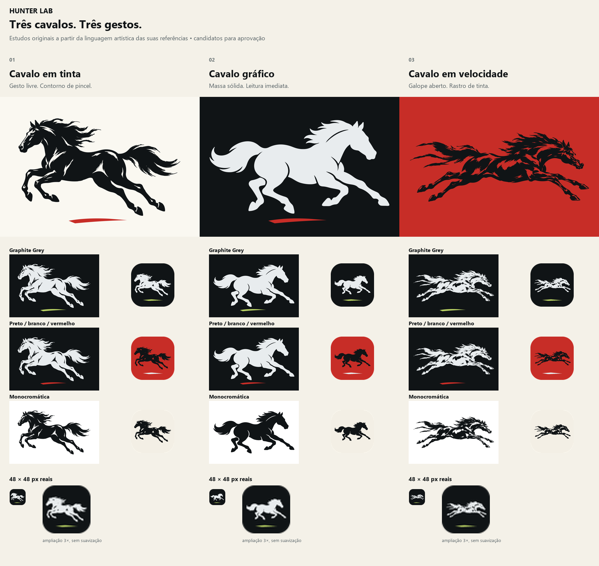
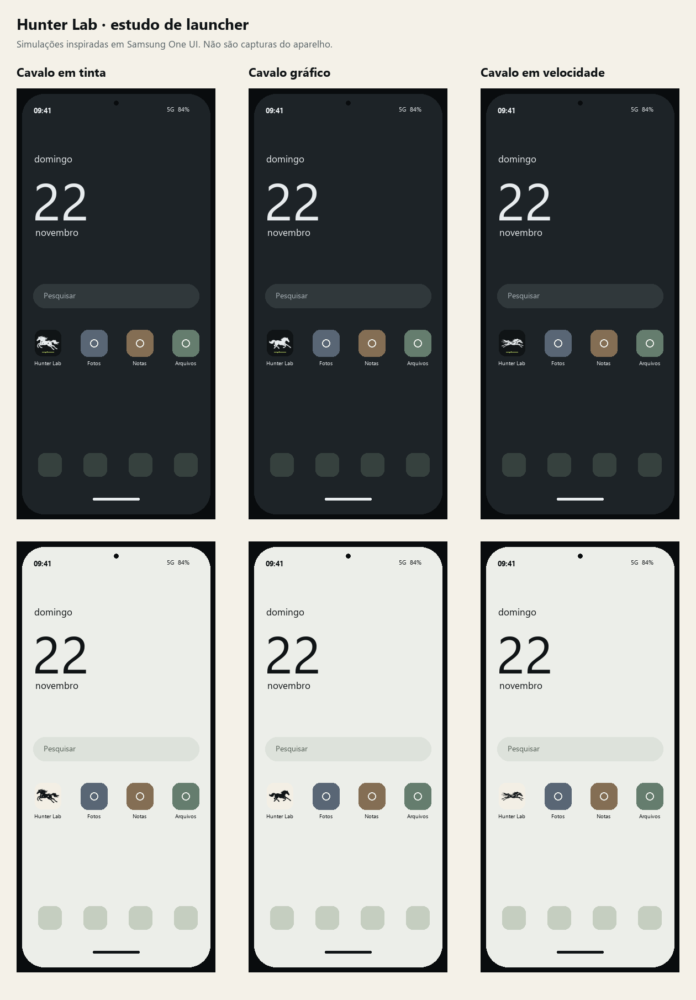

# Hunter Lab — cavalo inteiro em movimento

Estado: três candidatos para aprovação visual. Nenhum aplicado ao aplicativo.
Branch `feat/ui-horse-art-references`, base main 0.3.1 (`78f2e8a`).

## Direção e referências

As três imagens fornecidas em 22/11/2026 foram abertas e examinadas localmente antes da criação.
O arquivo sem sufixo mostra tinta preta sobre vermelho; `(1)` mostra o cavalo preto sobre branco com estrelas;
`(2)` mostra a silhueta clara sobre preto. Os arquivos de referência não são redistribuídos.
Usamos corpo inteiro, galope, contraste e gesto orgânico como direção. Não houve vetorização das referências,
reutilização de estrelas ou reprodução de sua composição.

As novas artes foram geradas com `image_gen`, modo integrado, depois convertidas em paths vetoriais editáveis.
Os prompts estão em [PROMPTS.md](PROMPTS.md). Isso não constitui pesquisa de anterioridade nem garantia de exclusividade jurídica.
A1/A2 continuam intactas na branch `feat/ui-hunter-horse-refinement`, commit `964d3fb`; não são candidatas desta rodada.

## Comparação

| Proposta | Personalidade | Leitura a 48 px | Limitação |
|---|---|---|---|
| [01 — Cavalo em tinta](01-ink/symbol.svg) | Mais pictórica, crina aberta, gesto livre | Boa na variante simplificada | Cortes finos da arte grande desaparecem |
| [02 — Cavalo gráfico](02-graphic/symbol.svg) | Formas sólidas e galope compacto | Melhor das três; maior separação entre massas | Menos expressiva que a 01 e a 03 |
| [03 — Cavalo em velocidade](03-speed/symbol.svg) | Galope estendido, textura e cauda em rastros | Reconhecível; menor altura útil | Textura se concentra; mais adequada a aplicações grandes |

Recomendação para ícone do aplicativo: **02**, por conservar corpo, cabeça e quatro patas com menos ruído.
Para uma marca mais pictórica, **01** é a alternativa mais equilibrada. A **03** é a mais expressiva em grande escala.
Escolha final permanece com o usuário; a recomendação não altera o launcher.

## Arquivos de cada proposta

- `source-generated.png`: arte original gerada, preservada.
- `symbol.svg/png`: símbolo principal; SVG contém paths reais, sem raster embutido.
- `on-light`, `on-dark`, `graphite`, `reference`, `monochrome`: aplicações SVG/PNG.
- `icon-foreground.svg/png`, `icon-monochrome.svg/png`: variante para tamanhos pequenos.
- `icon48-{graphite,reference,mono}.png`: PNGs reais de **48 × 48 pixels**.
- `icon48-*-6x.png`: ampliação sem interpolação para examinar pixels, não demonstração de mais detalhe.
- `adaptive-circle.png`, `adaptive-squircle.png`: duas máscaras.
- `launcher-{graphite,reference,mono}.png`: simulações de launcher inspiradas no Samsung One UI.
- `android-candidate/`: foreground, monochrome, background e wrappers adaptativos/round. **Fora de `app/src/main/res`.**
- `trace.svg`, `icon-trace.svg`: intermediários vetoriais para reprodução. Os inputs de trace derivam apenas das nossas artes.

## Verificação

Os ícones usam camadas 108dp com exibição central 72dp e máscara sobre essa área, conforme o recorte adaptativo.
A silhueta fica dentro do círculo seguro de 66dp. A variante pequena fecha apenas cortes e fiapos muito finos;
não muda a pose nem reduz o cavalo a uma cabeça. No monochrome, a cor final vem do launcher.

As três pastas de recursos passaram em **AAPT2 36.0.0 compile + link**, contra a plataforma 37.2,
num pacote temporário de validação, fora dos fontes do app. XML/SVG válidos, sem imagens ou fontes externas embutidas.
Paths dos vetores Android abaixo de 32 mil caracteres. Revisão visual dos PNGs da prancha e das máscaras realizada.
Contrastes calculados: claro/grafite **15,58:1**; lima/grafite **10,69:1**; grafite/vermelho **3,38:1**.
O vermelho é campo gráfico, sem texto miúdo sobre ele.

As telas Samsung são **simulações**, com placeholders neutros para os outros aplicativos. Não são screenshots de hardware.
Não houve instalação, conexão BLE, alteração de assinatura, pacote, dados ou código funcional.
Build/Lint do app não validam a qualidade artística; o CI verifica que a branch preserva a base funcional.

Suíte local da branch: **448 testes, zero falhas; Lint zero achados; build debug aprovado**.
Nenhuma alteração em `app/`, `core/`, `protocol/` ou workflows.

Reprodução no desktop: `python tools/render_horse_art.py`, com Pillow, PyMuPDF e VTracer instalados.
Essas ferramentas não são dependências do Android. O script traça apenas `source-generated.png`, jamais arquivos do usuário.

## Próximo passo

Aprovar visualmente uma direção. Só depois preparar APK local de avaliação com o candidato escolhido, em branch própria.
A main e o ícone atual permanecem preservados. Não há release nem seleção definitiva nesta entrega.
