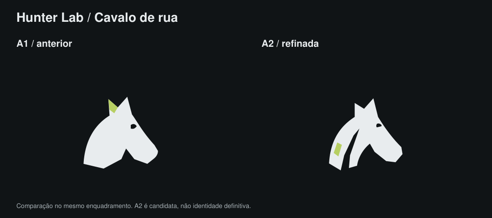
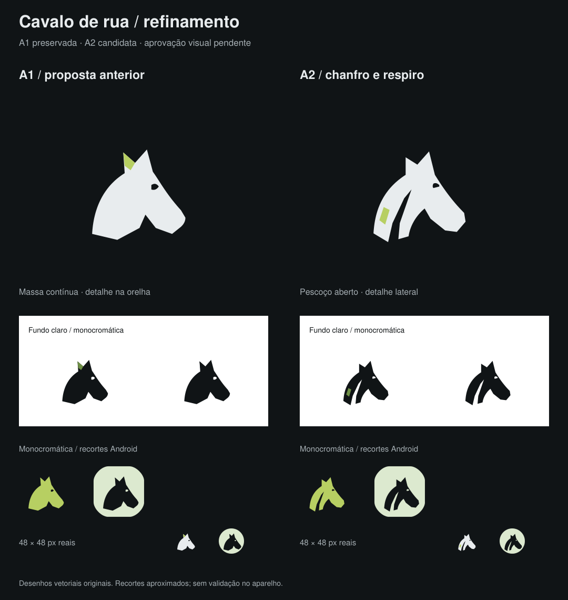
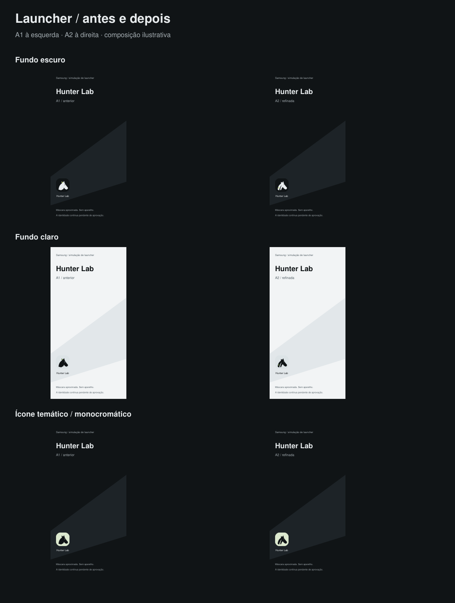
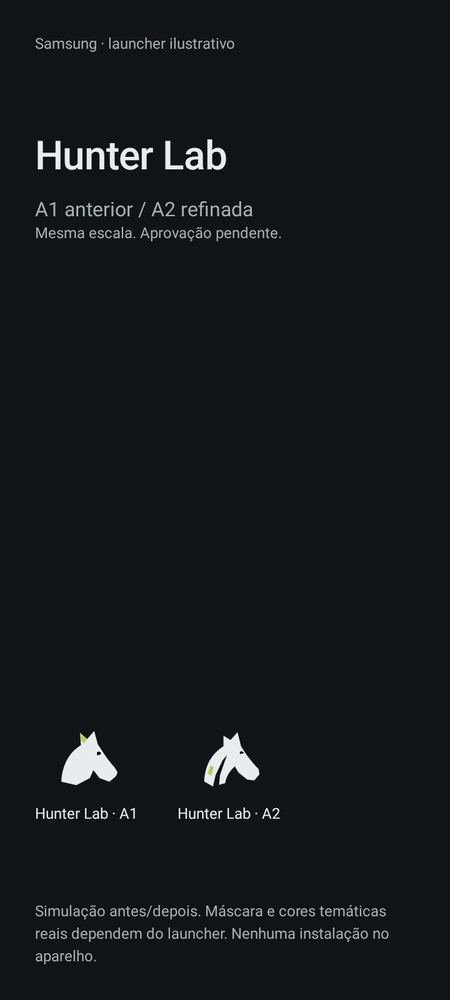
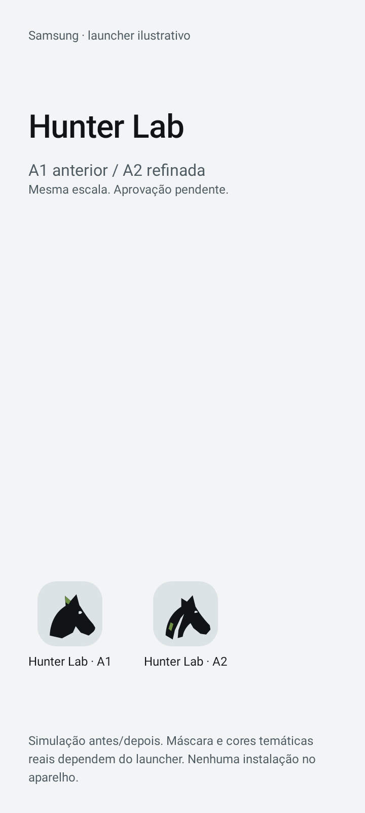
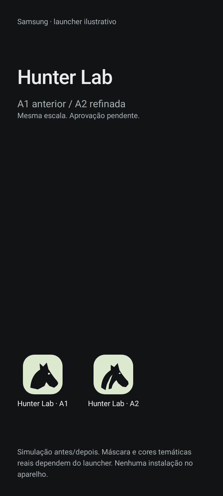

# Cavalo de rua — A1 × A2

**Revisão de 22/11/2026. A2 é candidata ao refinamento, não uma identidade aprovada.** Branch `feat/ui-hunter-horse-refinement`, worktree própria, baseada em `586837f`. A main funcional 0.3.1 permanece em `78f2e8a` e não recebeu alterações.

## O que mudou na A2

| Elemento | A1 preservada | A2 refinada |
|---|---|---|
| Cabeça | Volume mais compacto; focinho arredondado | Chanfro alongado, focinho com corte mais preciso e transição de testa/nariz contínua |
| Orelhas | Pontas altas, acento em uma orelha | Menos massa na orelha posterior e proporções mais contidas; sem acento na ponta |
| Pescoço | Massa contínua e base larga | Base mais inclinada e um único respiro aberto, com bordas de chanfro |
| Espaço negativo | Pequena abertura sob a cabeça | Canal no pescoço integrado ao contorno, sem ornamentos ou filetes soltos |
| Olho | Abertura arredondada | Abertura curta, discreta; não é o elemento que identifica a marca |
| Lima | Detalhe na orelha | Pequeno inserto lateral alinhado ao pescoço; referência abstrata aos detalhes da Graphite Grey |

A intenção é dar uma sensação de deslocamento e de peça recortada, combinando curva de nuca e corte preciso. O grafite é plano, sem brilho, textura artificial, sombra, gradiente ou efeito de metal cromado. O cavalo permanece reconhecível sem o lima. Não foram adicionados emblemas, brasão, raio, engrenagem ou símbolos da Royal Enfield.

Foram comparadas internamente variações de contorno fechado, respiro curvo e chanfro aberto. A A2 apresentada usa o chanfro aberto por manter uma relação mais mecânica entre massa e vazio. A seleção é uma recomendação visual para discussão, **não aprovação definitiva do usuário** nem garantia jurídica de exclusividade.

## Comparação no mesmo enquadramento

A1 e A2 usam o mesmo canvas e o mesmo viewport adaptativo; não foi ampliada uma delas para favorecer a comparação. O vazio torna a A2 visualmente mais leve, embora as dimensões gerais permaneçam próximas.

[PNG A1 em 48 × 48 px](icon48-a1.png) · [PNG A2 em 48 × 48 px](icon48-a2.png). São **pixels reais**, sem confundir com dp. As prévias Android também incluem ícones de 48 dp; a densidade do aparelho define sua quantidade de pixels.

## Launcher Samsung — composição ilustrativa

A1 à esquerda, A2 à direita, em fundo escuro, claro e ícone temático. Máscaras aproximadas, sem afirmar execução no Samsung ou no Pixel.

| Contexto | A1 | A2 |
|---|---|---|
| Escuro | [Abrir](launcher-dark-a1.png) | [Abrir](launcher-dark-a2.png) |
| Claro | [Abrir](launcher-light-a1.png) | [Abrir](launcher-light-a2.png) |
| Monocromático | [Abrir](launcher-mono-a1.png) | [Abrir](launcher-mono-a2.png) |

As cores de um ícone temático real dependem do launcher e do tema do usuário. Os desenhos usam uma única máscara de silhueta para esse caso. Sobre branco, o detalhe usa verde Hunter `#6E8F45`; sobre grafite, lima `#B7CF62`. O texto e a silhueta principal não dependem do verde.

## Prévias Android dos recursos reais

Renders Layoutlib revisados, com os dois drawables lado a lado. São diferentes das composições SVG acima: comprovam a aparência dos recursos no renderizador Android, sem afirmar comportamento no hardware do celular.

| Escuro | Claro | Monocromático |
|---|---|---|
|  |  |  |

[Prancha Android completa](android/comparison.png) · [320 dp / fonte 150%](android/font150.png).

## Fontes e preservação

- **A1:** os 23 arquivos de arte e drawables anteriores são os mesmos blobs Git de `586837f`. Não foram reexportados nem sobrescritos. [Fontes originais](../concepts/a-cavalo/).
- **A2:** [símbolo SVG](refined/symbol.svg), [claro](refined/on-light.svg), [escuro](refined/on-dark.svg), [monocromático](refined/monochrome.svg), [assinatura horizontal](refined/wordmark.svg) e XMLs em `refined/`.
- [Fonte do comparativo](comparison.svg) e [fonte dos launchers](launchers.svg) continuam editáveis.
- `tools/render_horse_refinement.py` gera somente os novos assets e lê A1 como entrada. Não executa a rotina antiga nem escreve os arquivos anteriores. PyMuPDF é ferramenta desktop opcional com licenciamento AGPL/comercial, já descrito nos avisos; não é dependência Android.

A2 possui foreground e monocromático compilados para as prévias. A cor de fundo separada e os wrappers adaptativo/arredondado estão preparados em `refined/`; foram compilados na revisão inicial e ficam fora dos recursos do APK enquanto não forem usados, evitando avisos de recursos sem uso. **AndroidManifest e os recursos ativos `ic_launcher*` não foram alterados.** A2 aparece somente nos componentes de revisão. Para ativá-la futuramente será necessária a aprovação visual e uma integração controlada dos recursos escolhidos; não mesclar toda a branch de estudos automaticamente.

Pacote, versão, assinatura, permissões, navegação, GPS, radares, Playground, protocolo e BLE permanecem intocados. Nenhuma instalação no celular, sessão com a moto ou teste físico ocorreu.

## Verificação

- A2: raio máximo rasterizado da silhueta **32,635 dp** em relação ao centro do canvas de 108 dp; dentro do círculo seguro de raio 33 dp.
- Arquivos de redução A1/A2 verificados como 48 × 48 px.
- Paleta preservada: grafite `#101416`, apoio `#1D2327`, tinta `#E8ECEE`, lima `#B7CF62` e verde de apoio `#6E8F45`.
- Contrastes da paleta: tinta/grafite 15,58:1; lima/grafite 10,69:1; grafite/branco 18,52:1; verde Hunter/branco 3,70:1. Isso não garante cores arbitrárias escolhidas por launchers de terceiros.

- Cinco renders Android finais revisados: comparação completa, fonte 150% em 320 dp e launchers escuro/claro/monocromático. Sem texto truncado nas pranchas finais; a representação do recorte permanece aproximada.
- `./gradlew test :app:lintDebug :app:assembleDebug --max-workers=2 --console=plain`: **BUILD SUCCESSFUL**.
- **448 testes aprovados** (protocol 115, core 310, app 23), zero falhas, erros ou ignorados.
- Lint final: **No issues found**. Três avisos iniciais de recursos preparados sem uso foram resolvidos mantendo os wrappers/fontes de fundo em `refined/` até a integração aprovada; nenhuma verificação foi desabilitada.
- Actionlint e auditoria Gitleaks dos arquivos publicáveis e histórico Git sem achados. Arte A1 e launcher ativo conferidos sem alterações; Manifest, versão, assinatura e código funcional preservados.

A main fica preservada independentemente da escolha visual. A2 continua aguardando aprovação; nenhum teste físico foi feito.
