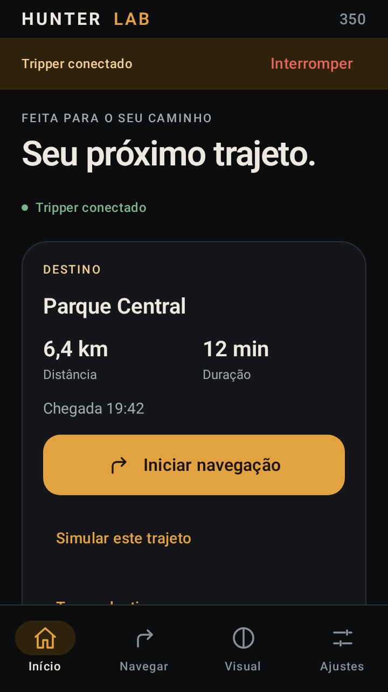
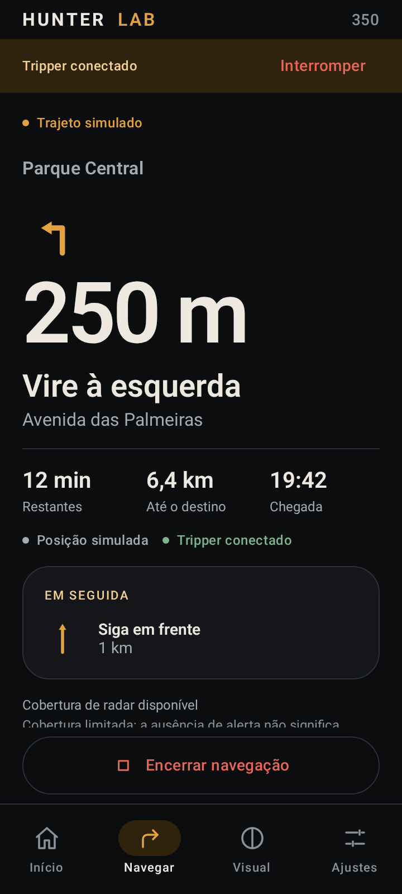

# Prévias da interface Hunter Lab

Renders reais de composables, produzidos por Layoutlib/AGP 9.5.2. Dados de trajeto e destinos são fictícios e pertencem apenas a `ui/preview/SampleStates.kt`. Não são capturas de um aparelho nem evidência de comunicação com o Tripper.

As telas ficam na branch `feat/ui-hunter-dashboard`; a main permanece separada. O estado e as pendências estão no [relatório da UI](../CODEX_REPORT.md).

| Estado | Prévia |
|---|---|
| Início com rota — 360 × 640 dp | [inicio.png](previews/inicio.png) |
| Navegação — 360 × 800 dp | [navegacao.png](previews/navegacao.png) |
| Alerta de radar — 360 × 800 dp | [radar.png](previews/radar.png) |
| PIN — 360 × 640 dp | [pin.png](previews/pin.png) |
| Personalização — 360 × 800 dp | [personalizacao.png](previews/personalizacao.png) |
| Configurações — 360 × 800 dp | [configuracoes.png](previews/configuracoes.png) |
| Fonte 150% — 320 × 640 dp | [fonte-150.png](previews/fonte-150.png) |
| Tela ampla — 840 × 1000 dp | [amplo.png](previews/amplo.png) |
| Sem provedor configurado | [vazio.png](previews/vazio.png) |
| Base publicada, sem bindings do MVP | [base-publicada.png](previews/base-publicada.png) |
| Recálculo/loading | [loading.png](previews/loading.png) |
| Erro de rota | [erro.png](previews/erro.png) |

As telas rolam quando o conteúdo excede a área útil; Encerrar navegação e a faixa global de Interromper permanecem fora da rolagem. As prévias de fonte ampliada não reduzem a preferência de tamanho do usuário.

## Início

## Navegação

## Reproduzir no Android Studio

Abrir `app/src/main/java/dev/hunterlab/app/ui/preview/SampleStates.kt` na visualização de Compose. Há 12 funções `@Preview` para os estados e larguras acima, sem Bluetooth, rede, chaves ou dispositivo conectado.

A renderização host usada nesta revisão foi temporária; o projeto não ganhou plugins, flags experimentais nem dependências de screenshot permanentes.
